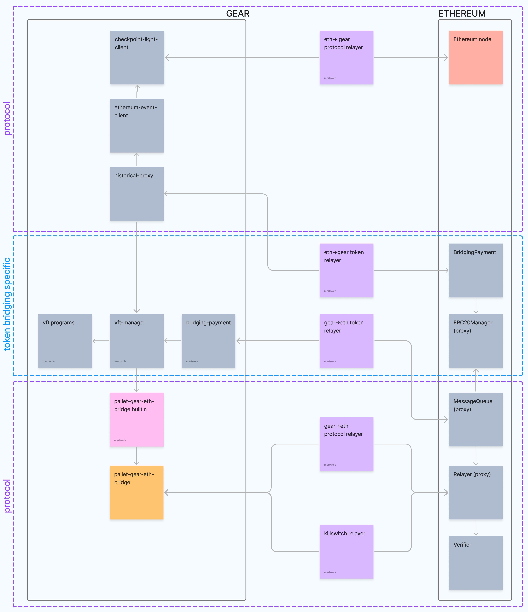
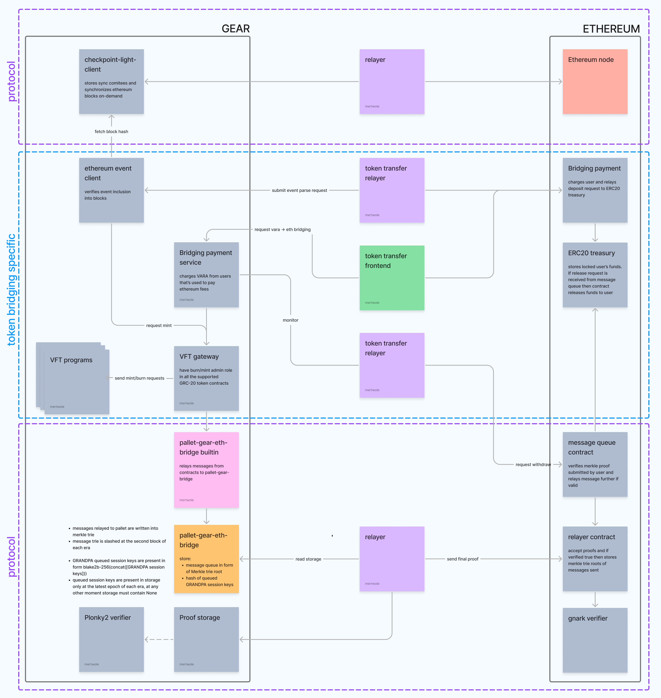
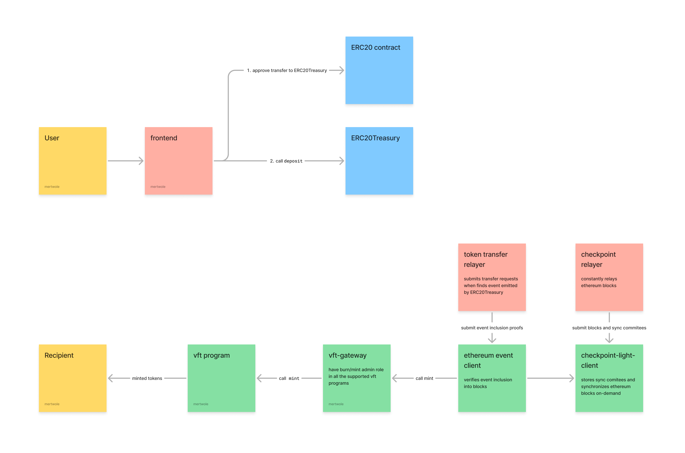

# Gear Bridges

Gear Bridge implements authenticated cross-chain messaging and asset transfers between Ethereum and Gear-based blockchains, such as the [Vara network](https://vara.network/). Vara→Ethereum roots use BEEFY-authenticated MMR proofs; Ethereum→Vara retains its independent Beacon light-client and receipt-proof path.

## BEEFY/MMR authentication

The outbound implementation lives in `tools/beefy-relay`, `ethereum/src/beefy`, and
`VaraQueueRootVerifier.sol`. A commitment follower advances `BeefyClient`; an
authenticated MMR root publisher registers historical queue roots in `MessageQueue`;
the retained message relayers deliver individual messages after queue maturity.
The typed verifier accepts the original source block, root and canonical v2 proof
envelope, and trusts only the configured client's latest accepted MMR anchor.

The consensus sources derive from Snowbridge commit
`1201293e482ef052b9c3989dcf680046704fef3d`. Local verification and deployment
hardening goes beyond compiler/import changes; this is not identical audited
upstream bytecode. Both interactive and Fiat-Shamir verification remain
supported. Fiat-Shamir verifies the selected sample, while the Rust relay checks
every available signature.

Rust and Foundry share `ethereum/test/fixtures/beefy-interop.json`. Its synthetic
signatures, SCALE leaves and commitments, MMR proofs, and canonical ABI envelopes
are reproducible with the deterministic development keys in `fixtures.rs`.
Fixture agreement alone does not qualify code changes or deployed artifacts.
Recorded Hoodi committee-boundary data uses `.json.zst`, following the existing
Holesky fixture convention. Tests decompress the original bytes offline;
synthetic cross-language vectors remain readable JSON.

```sh
cargo test -p beefy-relay --lib
forge test --root ethereum --match-path 'test/*Beefy*.t.sol' -vvv
# Deliberately regenerate the shared fixture after a protocol change:
UPDATE_BEEFY_FIXTURE=1 cargo test -p beefy-relay --lib fixtures
```

The local trusted genesis checkpoint and sampling parameters are not production
security policy. Queue maturity/conflict hardening and source/domain checks do
not authorize production activation or migration of an existing deployment.
For isolated local nodes and a real Hoodi bridge, use the
[local deployment guide](docs/running-the-bridge.md#local-nodes-and-hoodi).

Fresh BEEFY deployment scripts share bootstrap validation in `ethereum/test/Base.sol`;
its `deployBridge()` also owns governance, tokens and queue deployment. `BeefyHoodi`
selects the message-only profile (queue at the starting deployer nonce + 5).
`BeefyLocal` and `BeefyTokens` retain token deployment; the generated-token profile
places the queue at nonce + 12, while complete existing-token overrides change that
creation count. Use the existing scripts' queue prediction and guards.
After Solidity test or script changes, regenerate the compiler artifacts listed in
the CI API-file check: AST identifiers can change even when ABI and bytecode do not.

Queue UUPS upgrades retain the existing `DEFAULT_ADMIN_ROLE` authority.
BEEFY initialization and `migrateToBeefy` additionally bind an independently
reviewed positive-delay recovery timelock. It may replace only an expired verifier
with a live, forward checkpoint for the same source/MMR history; it receives no
UUPS role and cannot reset custody, registered roots or replay state.
See the [recovery policy and mainnet release gates](ethereum/README.md#expiry-recovery-and-initializer-scope).
Fresh-deployment scripts do not migrate existing custody.

The normal `beefy-relay` binary owns authenticated source following, durable root
publication and history audit. Local setup belongs to the explicit `beefy-deploy`
target (`--features deployment --bin beefy-deploy`), not a campaign supervisor.
The deployment feature adds the program WASMs; the normal actor does not need them.
No Python, launchd, sealed-run manifests or uninterrupted soak are required to
run the reusable actor. Original transaction journals and finality checks remain
mandatory on restart. Re-included originals remain held until their new inclusion
is finalized. Keep `root-publications/finality-history/` alongside indexed root
journals: it is owned archive data, not a root publication. Unknown inventory
entries and symlinks in place of that directory remain rejected.

Root-publication holds do not stop authenticated client heartbeats or mandatory
handovers. Every registered signed original or unsigned nonce reservation fences
other root publications until authenticated finalized disposition. A stale signed
proof must settle through its original bytes; only a proved no-effect outcome
permits a fresh publication attempt.

Use `beefy-relay tokens-follow` for commitment following and root publication,
`tokens-publish-root` for standalone publication, and `tokens-history-audit`,
`bridge-status` and `bridge-events` for audit/status. Retained `relayer` commands
provide token/manual delivery in both directions and the independent `eth-gear-core`
checkpoint worker. Each independently submitting process needs a distinct EVM
fee-payer account; never share the root publisher's nonce account with delivery.

The observer-only `relayer kill-switch` compares canonical destination roots,
including hot blocks, with the exact finalized historical source root. Missing
or pruned source state alone is not a mismatch. A finalized successful challenge
stops the observer for separately authorized operator/governance response; it
never repairs a root or unpauses. The challenge
pause is finite (two days); persistent incidents require the existing governance
pause. See [proof authentication](docs/circuits-and-proofs.md) and
[bridge internals](docs/internals.md).

## Security

The following audits are historical evidence for their pinned revisions, not
qualification of the current BEEFY adapters or authorization of a public cutover.

[Ethernal](https://ethernal.tech/) team have performed partial [audit](audits/ethernal.pdf) of the code, which covered the following scope for the commit [d42251c](https://github.com/gear-tech/gear-bridges/commit/d42251c3c9d94309a7855d6d774c6054a139a674):

- [prover](https://github.com/gear-tech/gear-bridges/tree/d42251c3c9d94309a7855d6d774c6054a139a674/prover)
- `plonky2` [circuits](https://github.com/gear-tech/gear-bridges/tree/d42251c3c9d94309a7855d6d774c6054a139a674/circuits) for crypto primitives
- `ethereum` [smart-contracts](https://github.com/gear-tech/gear-bridges/tree/d42251c3c9d94309a7855d6d774c6054a139a674/ethereum)

> [!WARNING]
> The first audit reported that a malicious source RPC could halt the historical proof producer. Current source identity, archive availability and finalized-history checks remain operational trust boundaries; do not treat an arbitrary RPC response as authenticated progress.

They've also performed another [audit](audits/ethernal_2.pdf) which covered the following scope for the commit [8b1018bd](https://github.com/gear-tech/gear-bridges/commit/8b1018bd8a2b882a2b9d4fc84c12666144b54efd):

- `gear` [programs](https://github.com/gear-tech/gear-bridges/tree/8b1018bd8a2b882a2b9d4fc84c12666144b54efd/gear-programs)
- `ethereum` [smart-contracts](https://github.com/gear-tech/gear-bridges/tree/8b1018bd8a2b882a2b9d4fc84c12666144b54efd/ethereum/src)

## High-Level Design

The **Gear <-> Eth** transfer protocol allows relaying messages from Gear-based blockchains to Ethereum and back. These messages contain generic data defined by protocols built on top of the bridge. The protocol doesn't guarantee the order in which messages are relayed.

This repository contains the implementation of a token bridging protocol built on top of a more generic messaging protocol.

### Components of `Gear <-> Eth` bridge

Historical architecture diagrams (pre-cutover; not the current BEEFY composition):

<details>
    <summary>Historical diagrams</summary>
    
    
</details>

#### Protocol part

- **Pallet-Gear-Eth-Bridge Built-in Actor**: a [Built-in Actor](https://wiki.gear-tech.io/docs/gear/features/builtin-actors) - the entry point into the generic bridging protocol. Receives messages from any actor on the Gear network and relays them to `pallet-gear-eth-bridge`.
- **Pallet-Gear-Eth-Bridge**: Stores outbound messages in a cumulative binary Merkle tree within each queue. The native BEEFY/MMR runtime commits a destination-bound queue snapshot and next-authority data; BABE authoring and GRANDPA finality remain source-chain responsibilities.
- **BeefyClient**: Authenticates BEEFY commitments, authority handovers and source freshness against configured bootstrap authority sets, retaining the accepted MMR anchor.
- **VaraQueueRootVerifier**: Verifies canonical v2 historical queue-snapshot inclusion against the client's latest live MMR anchor, binding source height, root, initialization and destination domain through `IVerifier.safeVerifyProof(uint256 sourceBlock, bytes32 merkleRoot, bytes proof)`.
- **MessageQueue(proxy)[^1]**: Registers authenticated queue roots and processes individual message Merkle proofs after maturity, preserving historical roots, global nonce replay protection and custody dispatch.
- **Checkpoint-Light-Client**: Lazy ethereum light client that maintains `sync committee` validator list and is capable of verifying block headers using it.
- **Ethereum-Event-Client**: Program on Gear that's capable of verifying that some event was included into some block. To check validity of the block it requests data from `checkpoint-light-client`.
- **Historical-Proxy**: Program on Gear that maintains historical `eth-events-*` program addresses and redirects requests to a `eth-events-*` responsible of processing requested transaction. Serves as an exit point from core Ethereum -> Gear protocol.
- **Gear -> Eth Protocol Actors**: Existing `beefy-relay tokens-follow` follows native commitments and publishes authenticated historical roots; `tokens-publish-root` provides standalone publication. Original signed transactions, finality evidence and one-owner journals remain mandatory. There is no recursive proof producer or root-proof HTTP service.
- **Eth -> Gear Protocol Relayer**: Relayer that monitors `sync committee` changes and blocks signed by it on Ethereum and updates state of `checkpoint-light-client` using it.

#### Token transfer part

- **VFT**: A program capable of transferring, burning, and minting `vft` tokens. It repeats the implementation of the `ERC20` standard on the Gear network, the standard implementation `vft` can be found [here](https://github.com/gear-foundation/standards/tree/master).
- **VFT-Manager**: Receives `vft` tokens from users, burns/locks them, and emits a message to the `pallet-gear-eth-bridge` built-in actor. This message contains information about which token is being bridged, how much of it, and the recipient of funds on the Ethereum network. Also manages `Eth -> Gear` token transfers by verifying ethereum events using `historical-proxy` program and minting/unlocking corresponding tokens. It can work with both Ethereum and Gear supplied tokens. When token supply is based on Ethereum it will perform burns and mints of corresponding `VFT` tokens. When token supply is based on Gear it will perform locks and unlocks of corresponding `VFT` tokens.
- **ERC20Manager(proxy)[^1]**: Mirroring behaviour of `vft-manager` but on Ethereum side and without sending request to a `pallet-gear-eth-bridge`.
- **Bridging Payment**: Program on Gear and smart-contract on Ethereum that have the same functions. When bridging request is sent to them, they collect fees and relay this request to the corresponding smart-contract/program responsible of executing this request. Then some `token relayer` can observe events signaling that request have been processed and fee is paid and process this request on the other chain, using its own funds as tx fees. `bridging payment` services are fully in control of relayer that've deployed them, so to perform bridging using them one should trust the owner.
- **Gear -> Eth Token Relayer** and **Eth -> Gear Token Relayer**: These relayers hook to the events produced by `bridging payment` services and perform cross-chain actions to guarantee message delivery. For example, `gear -> eth token relayer` collects bridging fees from user on Gear. When merkle root that contain this message will be relayed to Ethereum, this relayer will send transaction to the `MessageQueue` that will trigger transfer from `ERC20Manager` to the user.

### Workflow of `Gear -> Ethereum` Token[^2] Transfer

- The user submits a bridging request through the frontend.
- Source approval/wrapping and the VFT-manager request use the existing atomic source batch.
- The `vft-manager` burns/locks VFT tokens and emits the original message through the bridge built-in actor.
- The finalized original bridge nonce is decoded before a separate ordinary `PayFees(nonce)` transaction for auto-claim. Manual claim does not pay this delivery fee. Fee failure retains the original request and nonce for retry, not a second bridge request.
- The source bridge stores the message in its queue Merkle tree. The MMR leaf inserted at the next block commits that historical queue snapshot.
- The commitment follower authenticates a covering native BEEFY commitment in `BeefyClient`.
- The root publisher submits the historical snapshot's canonical MMR proof to `MessageQueue`, which calls `VaraQueueRootVerifier` and registers the root.
- The retained `gear-eth-tokens` worker (or a manual claimant) submits the original message and its separate Merkle inclusion proof after the registered block's maturity delay.
- `MessageQueue` verifies inclusion and replay protection, then dispatches the message to `ERC20Manager`.
- The `ERC20Manager` releases funds to the user's account on Ethereum.

### Workflow of `Ethereum -> Gear` Token[^2] Transfer



- The user submits his bridging request to `frontend`
- `frontend` submits `approve` call to the corresponding `ERC20` contract. Approve should allow `BridgingPayment` to spend amount of tokens that user have requested to bridge.
- `frontend` submits user request to the `BridgingPayment`.
- The `ERC20Manager` locks/burns `ERC20` tokens and emits an event.
- Eventually, the `eth->gear protocol relayer` (or another party) sumbits to `checkpoint-light-client` ethereum block which has block number bigger than one where event have been emitted.
- Eventually, the `eth->gear token relayer` (or another party) submits this event to `historical-proxy`
- `historical-proxy` verifies this event by sending a message to the corresponding `eth-events-*`.
- `eth-events-*` verifies that block where event is present is a valid finalized block on ethereum by calling `checkpoint-light-client`.
- `historical-proxy` routes user bridging request to `vft-manager`
- `vft-manager` sends message to a `vft` program that corresponds to a `ERC20` token that've been locked/burned in step 4. This message is either `transfer`(in the case when token supply is on Gear) or `mint`(in the case when token supply is on Ethereum).
- `vft` program mints/transfers tokens to a user address.

## Build and run

### Prerequisites

Install rust:
```sh
curl --proto '=https' --tlsv1.2 -sSf https://sh.rustup.rs | sh
```

Install forge:
```sh
curl -L https://foundry.paradigm.xyz | bash
foundryup
```

Install [Binaryen 133](https://github.com/WebAssembly/binaryen/releases/tag/version_133)
and put `wasm-opt` on `PATH` before building Gear programs. See the
[native build prerequisites](docs/running-the-bridge.md#prerequisites); an
unoptimized VFT manager can compile successfully but exceed the node's code-size limit.

> [!NOTE]
> To build `ring` crate follow [BUILDING.md](https://github.com/gear-tech/ring/blob/main/BUILDING.md).

### Run relayer

Build the retained relayer and BEEFY actor:
```sh
cargo build --locked --release -p relayer -p beefy-relay
```

And then run
```sh
./target/release/relayer --help
./target/release/beefy-relay --help
```
to see required parameters to start different kinds of relayers.

[^1]: (proxy) means that this contract is deployed behind [ERC-1967 Proxy](https://eips.ethereum.org/EIPS/eip-1967)

[^2]: Gear itself is not a blockchain network and has no native token. This refers to the token of any network built on Gear technology, such as Vara.
